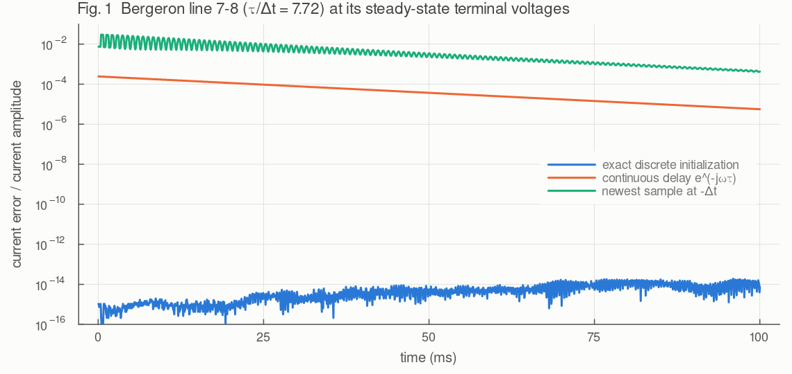
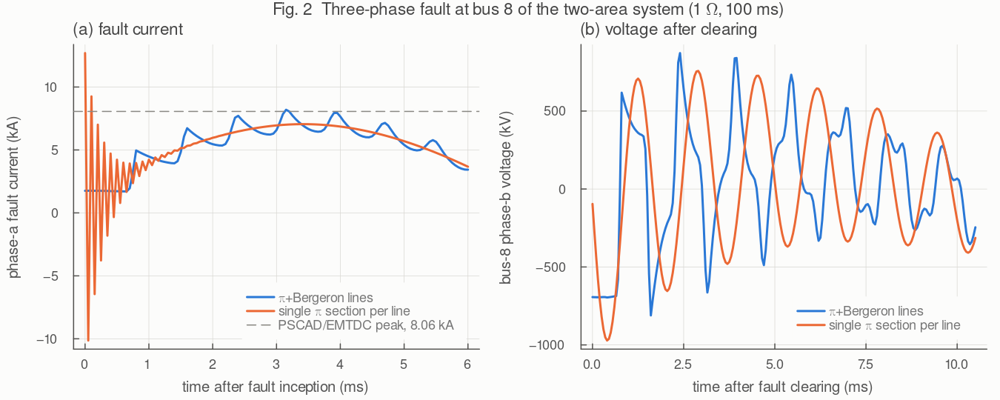
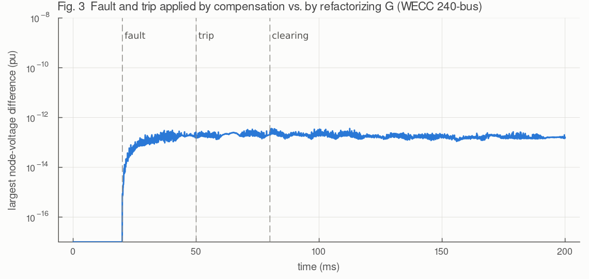
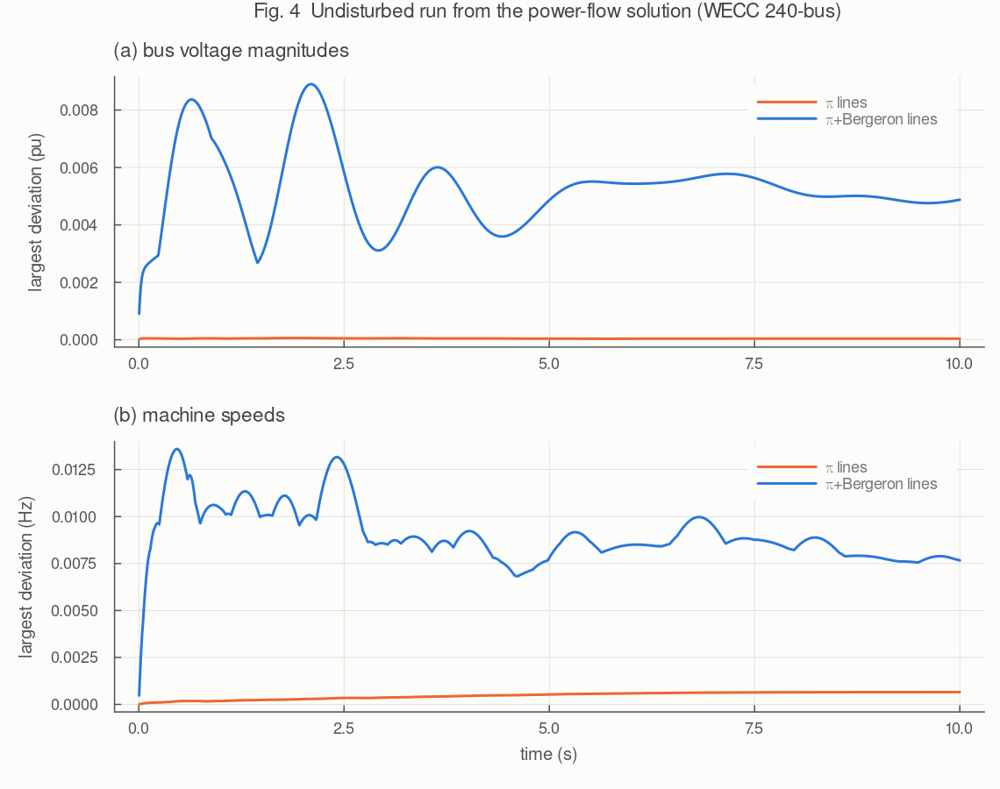
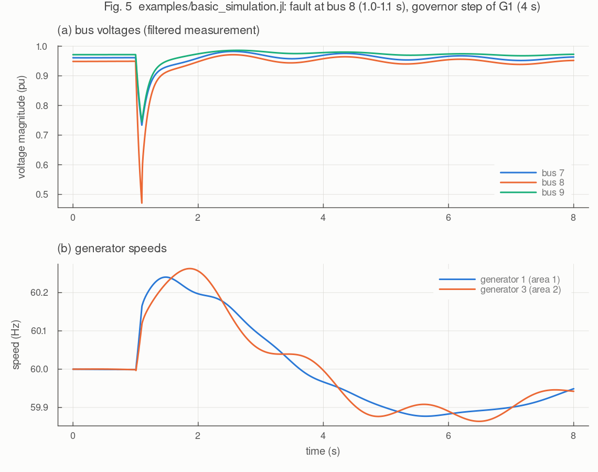
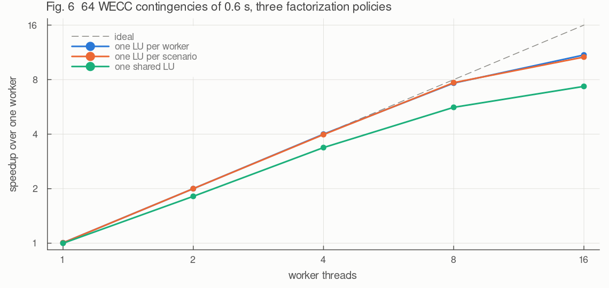

# Verification results

This page shows what has been checked in NodalEMT.jl and how well it holds, with figures. Every
result uses the two bundled systems in `data/psse/`, read by `load_psse` with the power flow
solved by PowerFlows.jl:

* the Kundur two-area system, 11 buses, `twoarea.raw` in RAW v33;
* the reduced WECC 240-bus system with 111 machines and 91 IBRs, `WECC240.raw` in RAW v34.

The automated tests in `test/` check the same properties on every run (`Pkg.test()`). To
regenerate the figures and numbers:

```
julia --project=docs -e "using Pkg; Pkg.develop(path=\".\"); Pkg.instantiate()"   # once
julia --project=docs --threads=16 docs/make_figures.jl
```

## 1. The power flow against PSS/E

`load_psse` re-solves the power flow of each `.raw` file with PowerFlows.jl. The table compares
the result with the solution that PSS/E stored in the same file, on the same network.

| | Two-area | WECC 240-bus |
|---|---|---|
| Largest bus-voltage magnitude difference | 4.1e-6 pu | 7.9e-6 pu |
| Largest bus-voltage angle difference | 1.1e-6 rad | 6.1e-6 rad |
| Largest unit active-power difference | 1.8e-4 MW | 4.3e-3 MW |
| Power balance of the EMT network, re-solved power flow | 1.2e-5 pu | 7.1e-4 pu |
| Power balance of the EMT network, PSS/E's stored solution | 2.8e-4 pu | 5.4e-2 pu |

The "power balance" rows give the largest power mismatch at any bus when the network that the
EMT model builds is evaluated at the solution. The re-solved power flow balances that network
better than PSS/E's stored solution:

* **Stored solution:** its voltages are rounded to five decimals. Near-zero-impedance branches
  of the WECC system (X = 1e-4 pu) turn that rounding into a 5e-2 pu imbalance.
* **Re-solved power flow:** it is limited only by PowerFlows.jl, which keeps its admittance
  matrix in single precision.

The `.dyr` reader is checked against the PSS/E mapping of PowerSystems.jl, which was written
independently. All 149 parameter-position comparisons across the nine supported models agree.

Test: `test/test_psse.jl`.

## 2. Exact initialization of the Bergeron lines



The 386-µs tie line 7–8 of the two-area system (τ/Δt = 7.72) is driven at both ends by its
power-flow voltages. Any deviation of its terminal currents from the steady state of the
discrete line therefore comes only from the histories in its ring buffers at t = 0. The figure
compares three ways to fill them:

| Initialization | Largest current error in 100 ms (of the amplitude) |
|---|---|
| Exact periodic initialization of NodalEMT.jl (paper, eqs. (6)–(8)) | 1.9e-14, round-off |
| Histories of the continuous line, delay e^(−jωτ) | 2.4e-4, decaying slowly |
| Exact delay, but the newest sample at −Δt instead of 0 | 3.0e-2 |

Test: `test/test_bergeron.jl`.

## 3. A fault with traveling waves: the PSCAD/EMTDC case of the paper



A three-phase fault through 1 Ω at bus 8 of the two-area system, cleared after 100 ms by
opening all phases at once. The fault starts at the same point on the wave as in the paper's
PSCAD/EMTDC run.

* **Fault current (a):**
  * With Bergeron lines it builds up in steps spaced by twice the tie-line travel time,
    2τ = 0.77 ms. Its peak is 8.19 kA; PSCAD/EMTDC gives 8.06 kA.
  * With a single π section per line, the current overshoots to 12.69 kA and oscillates.
* **Voltage after clearing (b):**
  * With Bergeron lines it rings at several frequencies at once. The paper identifies them as
    the quarter-wave modes of the tie lines, at 696, 1956 and 3237 Hz; PSCAD gives 681, 1951
    and 3235 Hz.
  * With π sections it rings at a single frequency.

The repository does not contain the PSCAD/EMTDC waveforms; the paper compares them (Fig. 6).
Example: `examples/two_area_fault.jl`.

## 4. Compensation gives the result of refactorization



The WECC system is simulated twice with the same events:

* a fault through 0.001 pu at bus 2404 from 20 to 80 ms;
* a trip of generator 5 at 50 ms.

One run applies the events by compensation, keeping `G` and its factorization. The other adds
them to `G` and factorizes it again. Before the fault the two runs are identical. From then on
they differ by at most 3.6e-13 pu, which is round-off.

Test: `test/test_compensation.jl` (also bit-for-bit equality of batch scenarios with single
runs, in `test/test_batch.jl`).

## 5. An undisturbed start from the power flow



The WECC system runs for 10 s without any disturbance, starting from the re-solved power flow.

* **π lines:** this is the network the power flow solved. Bus voltages stay within 6e-5 pu of
  the power-flow values, and machine speeds within 7e-4 Hz of 60 Hz.
* **π+Bergeron lines (the default):** in steady state a Bergeron line carries the currents of
  the distributed line, which differ slightly from those of the π model in the power flow. The
  system therefore moves to a nearby operating point:
  * Bus voltages stay within 0.009 pu of the power-flow values and within 0.006 pu after 5 s.
  * The largest machine-speed deviation, 0.014 Hz, decays to 0.008 Hz at 10 s.

If a study needs its initial state exactly at the power-flow solution, use
`build_simulation(case; bergeron_threshold=Inf)`.

Test: `test/test_psse.jl` (both systems, 0.1 s).

## 6. A typical run



The run of `examples/basic_simulation.jl` on the two-area system:

* **Fault:** three-phase at bus 8 through 0.01 pu, from 1.0 to 1.1 s. Bus 8 drops to 0.47 pu
  in the filtered measurement (time constant 0.1 s) and recovers to 0.95 pu.
* **Speeds:** the machines accelerate during the fault, peak near 60.26 Hz and settle near
  59.95 Hz.
* **Governor step:** 0.002 at generator 1 at 4 s.

## 7. Speedup of scenario batches



This run uses 64 contingencies of 0.6 s on the WECC system. Each scenario, as in the paper and
in `examples/wecc_batch.jl`, has:

* a fault through 0.01 pu at 0.2 s for 60 ms, single-phase and three-phase in turn;
* a governor reference step at 0.4 s;
* in every third scenario, a generator trip at 0.5 s.

The batch ran on 1 to 16 worker threads, on two Intel Xeon Gold 5317 processors (16 cores)
with Julia 1.10.7. One worker took 69.3 s.

| Speedup over one worker | 2 workers | 4 | 8 | 16 |
|---|---|---|---|---|
| One LU factorization per worker (default) | 2.0 | 4.0 | 7.7 | 10.9 |
| One LU factorization per scenario | 2.0 | 4.0 | 7.7 | 10.7 |
| One shared LU factorization | 1.8 | 3.4 | 5.6 | 7.3 |

With a shared factorization, Julia's UMFPACK object lets only one substitution run at a time,
so the workers wait for each other. A factorization per scenario is as fast as one per worker,
but it stores 64 sets of LU factors instead of 16. All three policies give identical results
(`test/test_batch.jl`).

In the paper, 500 scenarios on 16 workers ran 12.2, 12.4 and 7.6 times faster than on one
worker. Timings depend on the machine and on the number of scenarios per worker.
